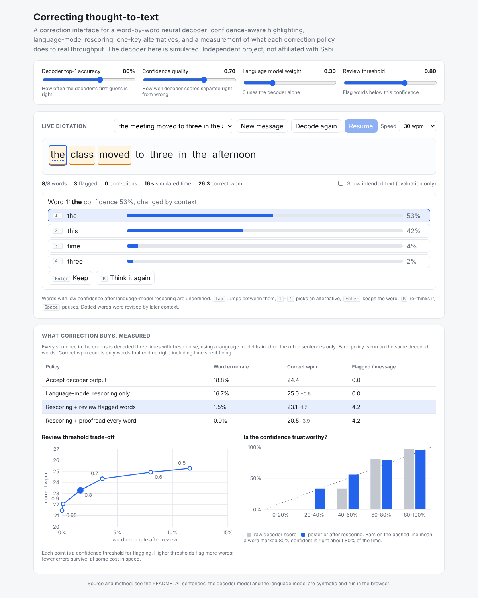

# bci-typing-correction

A correction interface for thought-to-text, and a measurement of what it is
worth.

A word-by-word neural decoder that produces text at conversational speed is
only useful if the text is right, or cheap to make right. This project builds
the layer between the decoder and the user:

- **Language-model rescoring** of the decoder's n-best lists, so context can
  fix words the decoder got wrong and revise earlier words as later ones
  arrive.
- **Confidence-aware highlighting** using the rescored posterior, so the user
  only looks at the words that are likely wrong.
- **One-key correction**: jump between flagged words with Tab, pick an
  alternative with 1-4, keep with Enter, or think the word again with R.
- **An evaluation harness** that simulates users finishing messages under
  different correction policies and reports what each one does to accuracy
  and to effective speed (correct words per minute, including time spent
  fixing).

Everything runs in the browser against a simulated decoder.



> Independent project. Not affiliated with or endorsed by Sabi, and it uses
> nothing of theirs. The decoder is a simulator whose parameters (top-1
> accuracy, how often the right word is in the n-best, how informative the
> confidence is) are knobs in the UI, so the interface and the policy
> analysis can be re-run against a real decoder's error profile.

## Why this, for Sabi

Sabi is building a wearable, non-invasive decoder for thought-to-text. At
around 30 words per minute, every decoding error costs the user more than
it would on a keyboard, because the natural fix (think the word again) takes
another full word's worth of time. Two questions follow, and this project
answers both with working code:

1. **How should the user fix errors?** Not by proofreading everything, which
   throws away much of the speed advantage, and not by ignoring them, which
   leaves roughly one word in five wrong at the default settings. The answer
   here is to flag the words whose rescored confidence is low, offer the
   decoder's own alternatives for them, and fall back to re-thinking only when
   the right word is not in the list.
2. **How do you choose the settings?** By measuring. The evaluation table and
   the threshold sweep show the accuracy and speed of each policy for the
   decoder profile set by the sliders.

## Results at the default settings

Decoder: 80% top-1 accuracy, correct word in the 4-best list 75% of the time
when top-1 is wrong, moderately informative confidence. 30 words per minute.
Leave-one-out over the 60-sentence corpus, three passes with fresh decoder
noise.

| Policy | Word error rate | Correct words per minute | Words flagged per message |
| --- | --- | --- | --- |
| Accept decoder output | 18.8% | 24.4 | 0 |
| Language-model rescoring only | 16.7% | 25.0 | 0 |
| Rescoring + review flagged words (threshold 0.8) | 1.5% | 23.1 | 4.2 |
| Rescoring + proofread every word | 0.0% | 20.5 | 4.2 |

Reviewing only the flagged words removes about 92% of the errors for a
5% loss of throughput relative to accepting the raw output, while
proofreading everything costs 16%. The threshold sweep in the app shows the
whole curve: at 0.7, about four percent of words stay wrong but throughput is
almost unchanged; above 0.9, nearly everything is caught but users review
most of the message.

The language model here is a bigram model trained on 59 short sentences, so
its contribution on its own is modest (12% fewer errors), and an
over-weighted language model makes things worse by talking a confident decoder
out of a right answer. The lambda sweep in `evaluate.ts` finds the useful
range (0.2 to 0.4). A production language model would move the second row
much further.

## How it works

```
src/model/
  corpus.ts     60 everyday messages (written for this project)
  lm.ts         Interpolated bigram LM with absolute discounting and continuation counts
  decoder.ts    Simulated word decoder: n-best lists, realistic confusions, noisy confidences
  rescore.ts    Viterbi and forward-backward over the n-best lattice
  session.ts    Live session state: streaming, revision tracking, locks, re-think
  evaluate.ts   Policy simulation, threshold and lambda sweeps, calibration
src/components/
  LiveSession.tsx   Streaming dictation with keyboard-driven correction
  Evaluation.tsx    Policy table, trade-off chart, calibration chart
```

### The simulated decoder

Errors from a real decoder are not uniformly random, and a correction UI
tuned on random errors would look better than it is. The simulator makes
wrong words come from plausible neighbors: homophones and near-spellings
(`to`, `two`, `too`; `for`, `four`), and semantic neighbors that a decoder
working from meaning might confuse (`morning`, `evening`; `monday`,
`friday`; `milk`, `coffee`). When the top guess is wrong, the right word is
usually still in the n-best list, which is what makes one-key correction
possible. Confidences separate right from wrong imperfectly, with a
"confidence quality" knob controlling how much.

### Rescoring

Each decoded word becomes a column of hypotheses. A path through the lattice
scores `log p_decoder(w_i) + lambda * log p_lm(w_i | w_{i-1})`. Viterbi gives
the displayed text; forward-backward gives each hypothesis's posterior given
the whole message so far. Two things fall out:

- **Context revisions.** When the next word arrives, an earlier word can
  change. The UI marks these with a dotted underline so the change is never
  silent.
- **Better flags.** The posterior accounts for whether a word fits its
  neighbors, not just how sure the decoder was. "The meeting moved to tree"
  can have a confident decoder and a very doubtful posterior.

Words the user has confirmed become single-hypothesis columns, so a
correction also conditions the words around it.

### The time model

| Action | Seconds |
| --- | --- |
| Decode one word | 60 / wpm (2.0 at 30 wpm) |
| Glance at a flagged word | 0.6 |
| Pick an alternative | 1.0 |
| Re-think a word | one decode + 1.0 overhead, up to three attempts |
| Proofread | 0.35 per word, catching 90% of remaining errors |

All values are in `DEFAULT_TIME` in `evaluate.ts`. They are assumptions,
chosen to be conservative for the review policies; with a real device they
should come from logged sessions.

## Running it

Requires Node 20 or newer.

```bash
npm install
npm run dev        # http://localhost:5173
npm test           # 17 tests
npm run build      # static site in dist/
```

Open `/?demo` to have the first flagged word selected automatically after
decoding finishes.

## Tests

The tests check that the language model is a proper distribution and prefers
seen continuations; that the decoder's n-best lists are normalized, sorted
and deduplicated and that it hits its configured accuracy; that rescoring
fixes a context error (`to`/`two`), produces normalized posteriors, and
reduces to the raw decoder at lambda 0; that review policies reduce errors
and proofreading is the slowest; that thresholds trade flags for errors in
the right direction; that every correction is charged time; and that the live
session streams, locks user picks and re-thinks words correctly.

## What I would do with real data

- Replace the simulator with logged decoder output (n-best lists and scores)
  and fit the time model from real sessions.
- Swap the bigram model for a small on-device transformer LM and re-run the
  lambda sweep.
- Learn the flagging threshold per user: someone who rarely accepts
  alternatives should see fewer flags.
- Use implicit signals of disagreement, if the hardware can provide them, as
  a second confidence source.

## License

MIT
